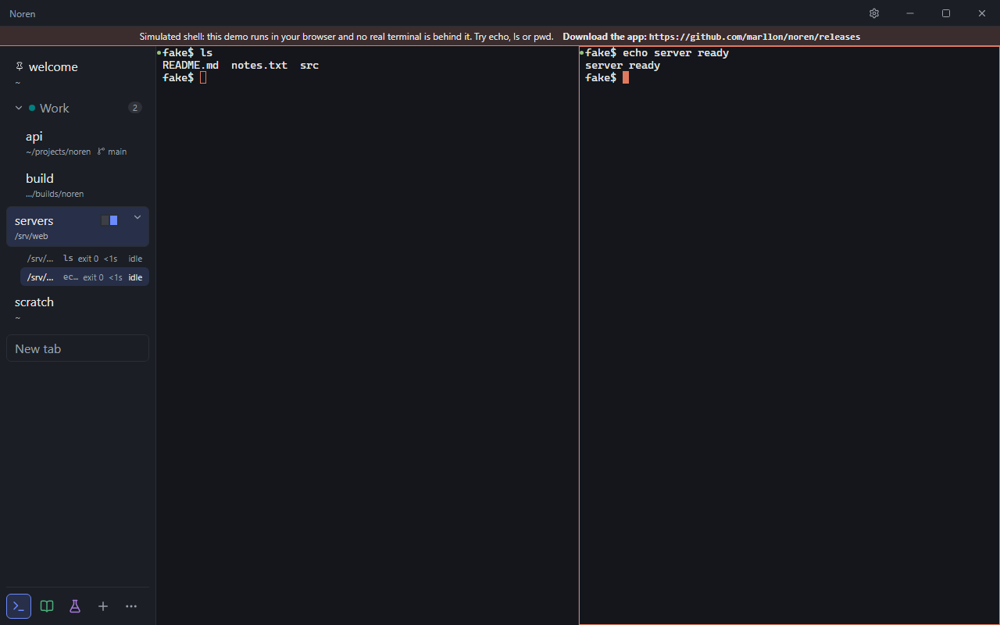
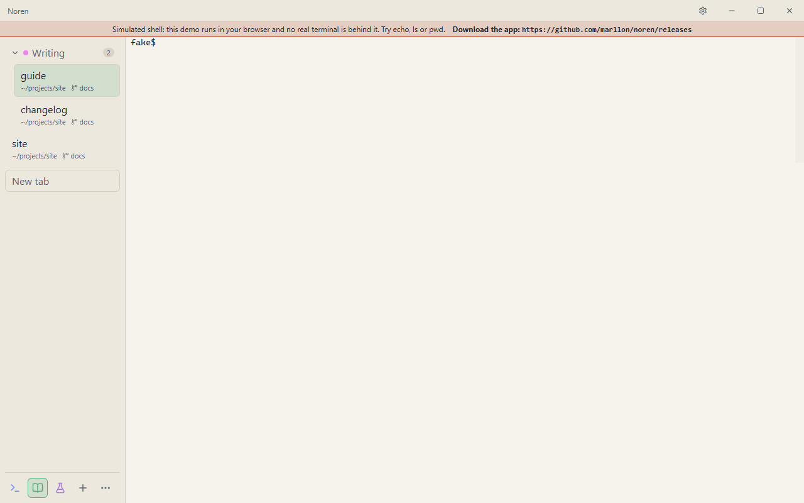
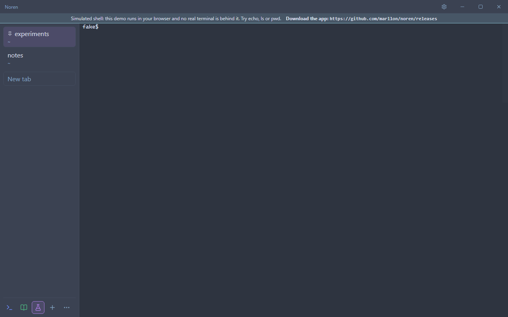
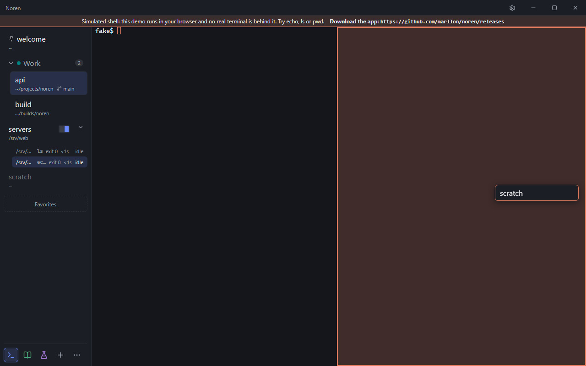
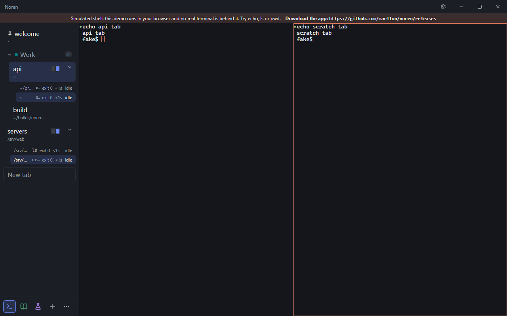
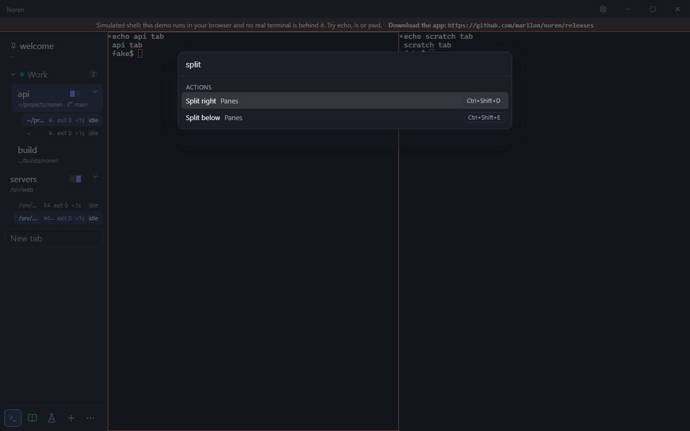
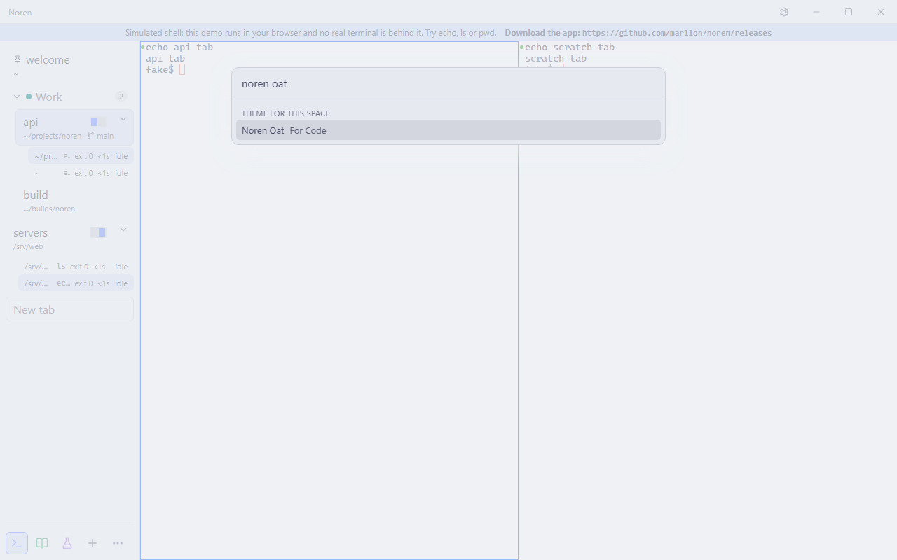
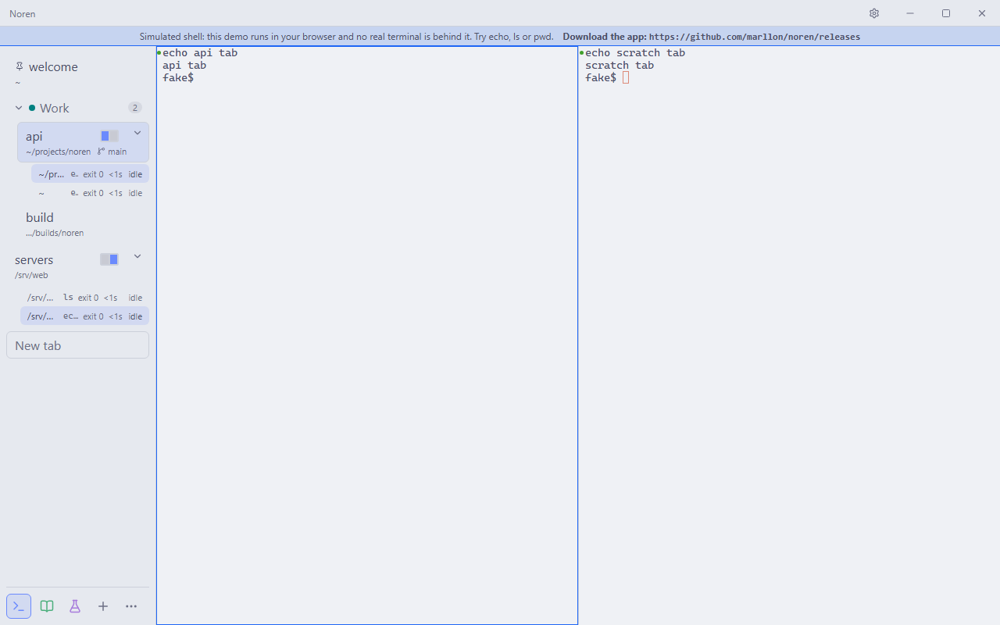
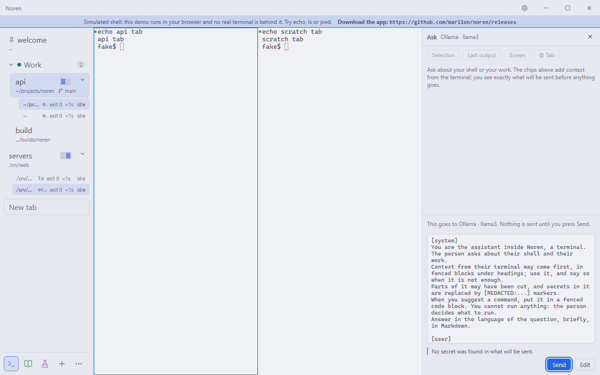
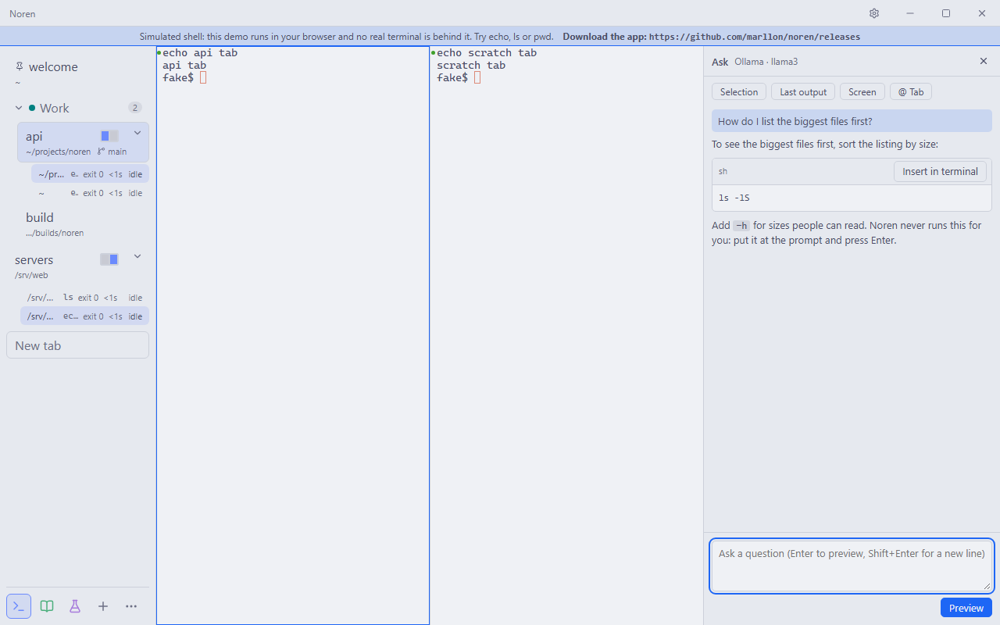

# Noren

A terminal you organize like a modern browser: spaces, groups, pinned tabs, splits saved as items, a command palette, and your own look. Windows first, with Linux builds and macOS not decided yet. Optional AI, local by default.



[Watch the 40-second tour](docs/media/noren-demo.webm) (webm, recorded on the web demo, where the shell is simulated).

**Status:** pre-alpha, under active development. There are no releases yet and the repository is not public.

Noren (暖簾) is the curtain split into panels that hangs in the doorway of Japanese shops: one space divided into panels, each leading somewhere.

## Why

A terminal session grows into dozens of tabs: servers, builds, a scratch shell, a repository for each project. A flat row of tabs stops helping long before the work does. Browsers solved this a decade ago with groups, pinned tabs, profiles and a search box that finds anything. Noren brings that organization to the terminal, without giving up what a terminal is for: a real shell, with every key reaching it unless Noren has an action for that key.

## Features

### Spaces with a look of their own

A space is a workspace: its own tabs, icon, color, theme, background image and git identity. Switch between them from the bar at the bottom of the sidebar or with Ctrl+Alt+1..9, and the whole window changes with the space.




### Groups, pinned tabs and a tree you can drive from the keyboard

The sidebar is a tree of groups and tabs with a second line of live information: folder, git branch, last command and its exit code, unread marks and a bell. Pinned tabs stay put, favorites sit in a bar at the top (drag a tab onto it, or right-click a tab, a project action or a profile in the palette), and the tree is an ARIA tree that works with the arrow keys. Prefer a classic layout? Put the tabs on top or hide the sidebar.

### Splits by dragging

Drag a tab from the sidebar onto the edge of a pane and the two join in a split. Split by shortcut too, zoom a pane, swap panes, or detach one back into its own tab. A split is a normal item of the sidebar, so it can be pinned, grouped and restored.




### A command palette for everything

Ctrl+Shift+P opens one palette for tabs of every space, spaces, every action, shell profiles, recent folders and themes. Prefixes narrow the list, and each action shows the shortcut it holds. See [docs/PALETTE.md](docs/PALETTE.md).



### Themes, per space or global

Eight built-in themes, a theme per space, and import of color schemes from other terminals. In the palette, highlighting a theme previews it on the whole window before you choose. Your own CSS mods and fonts are supported too; see [docs/THEMING.md](docs/THEMING.md).




### Optional AI, local by default

AI is off until you configure a provider. Keys live in the system keychain. Before anything is sent, you see exactly what will be sent, with secrets already replaced by markers. Answers can put a command at your prompt, but Noren never runs a command an AI suggested: you press Enter.




### And more

- Shell integration for PowerShell, bash, zsh and cmd (live folder, branch, last command, command marks, notifications for finished commands in background tabs).
- Session restore with scrollback after a restart, reopen closed tabs, and a library that searches inside the content of archived terminals.
- A quick terminal window with a global shortcut, which can be promoted to a normal tab.
- A commented `config.jsonc` with hot reload and a published schema ([docs/CONFIG.md](docs/CONFIG.md)).
- Interface in English and Brazilian Portuguese.
- No account and no telemetry.

## How it compares

Noren does not replace the tools below; it sits on top of the same shells. The differences are about what each kind of tool is built around.

| Kind of tool              | Built around                                                                 | What Noren does differently                                                                                                                        |
| ------------------------- | ---------------------------------------------------------------------------- | -------------------------------------------------------------------------------------------------------------------------------------------------- |
| Tabbed terminal emulators | A row of tabs and splits inside one window, configured in a file             | Adds an organizing layer: spaces, groups, pinned tabs, a searchable palette, a theme per space.                                                    |
| Terminal multiplexers     | Sessions that outlive the terminal, usable over SSH, driven by key sequences | Noren is a desktop app driven by mouse and keyboard. Its sessions end when the app closes today; a background daemon is planned (see the roadmap). |
| Browsers (as a model)     | Tabs, groups, pinned tabs, profiles, a command box                           | Takes that model to a terminal, with a real PTY and a shell that receives your keys.                                                               |

What to weigh before trying it:

- Noren is pre-alpha. It has fewer years of polish than established tools, and no signed builds yet.
- Windows is the first platform. The CI runs on Linux; macOS has no decided support.
- It is built on Tauri 2 (a system webview) instead of bundling a browser engine, and renders with xterm.js on WebGL.

## Install

There is no release to download yet: the repository is private and nothing is published. Two ways to try it today:

**From the code** (Windows, macOS or Linux toolchain; see [docs/DEV.md](docs/DEV.md) for the full setup):

```sh
pnpm install
pnpm desktop:build
```

On Windows this produces an NSIS installer and an MSI under `target/release/bundle/`. The Linux build is an AppImage and a deb, produced by the release workflow.

**From a release**, when there is one: download the installer for your system from the [releases page](https://github.com/marllon/noren/releases). Builds are not code-signed yet, so Windows may warn before the first run.

**On the web**: `pnpm demo:build` makes a static copy of the interface in `dist-demo/`, with a simulated shell, that runs in any browser.

## Keyboard shortcuts

The default ("safe") preset does not fight your shell: Ctrl+T, Ctrl+W and Ctrl+1..9 stay with the terminal. A "browser" preset is opt-in.

| Action                     | Shortcut                    |
| -------------------------- | --------------------------- |
| Open palette               | Ctrl+Shift+P                |
| New tab                    | Ctrl+Shift+T                |
| Reopen closed tab          | Ctrl+Shift+Alt+T            |
| Close pane                 | Ctrl+Shift+W                |
| Split right / below        | Ctrl+Shift+D / Ctrl+Shift+E |
| Zoom pane                  | Ctrl+Shift+Z                |
| Focus pane                 | Alt+arrows                  |
| Go to space 1..9           | Ctrl+Alt+1..9               |
| Go to tab 1..9             | Alt+1..9                    |
| Next / previous recent tab | Ctrl+Tab / Ctrl+Shift+Tab   |
| Search all tabs            | Ctrl+Shift+Alt+F            |
| Ask the AI                 | Ctrl+Shift+A                |
| Quick terminal             | Ctrl+`                      |

Every action can be rebound; the full list is in [docs/KEYBINDINGS.md](docs/KEYBINDINGS.md).

## Roadmap

The public plan, one summary per version (agents, persistent sessions, panes beyond the terminal, an open benchmark of local models, automation, extensions, sync), is in [docs/ROADMAP.md](docs/ROADMAP.md). Changes so far are in [CHANGELOG.md](CHANGELOG.md).

## Contributing

Contributions are welcome once the repository is public. Until then, read [CONTRIBUTING.md](CONTRIBUTING.md) and the [Code of Conduct](CODE_OF_CONDUCT.md). The design is in [docs/ARCHITECTURE.md](docs/ARCHITECTURE.md), the setup in [docs/DEV.md](docs/DEV.md).

The media in `docs/media/` is generated: `pnpm media` drives the web demo with a script and rewrites the screenshots and the video.

## Principles

- Your layout: sidebar on either side, hidden, or tabs on top.
- Windows is a first-class platform; the CI covers Linux only, and macOS has no support decided yet.
- Built on Tauri 2, not Electron.
- Keyboard and mouse both work for everything.
- AI is off until you configure it, never runs commands on its own, and shows what it will send.
- No account and no telemetry.

## Documentation

- [Architecture](docs/ARCHITECTURE.md)
- [Development setup](docs/DEV.md)
- [Contributing](CONTRIBUTING.md)
- [Security policy](SECURITY.md)
- [Security review](docs/SECURITY_REVIEW.md)
- [Third-party notices](THIRD_PARTY_NOTICES.md)

## License

Noren is released under the [MIT License](LICENSE).
